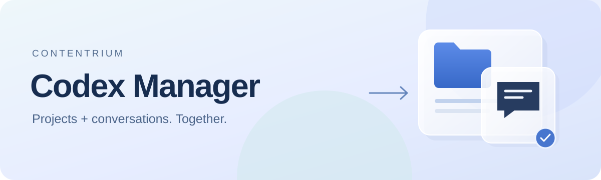
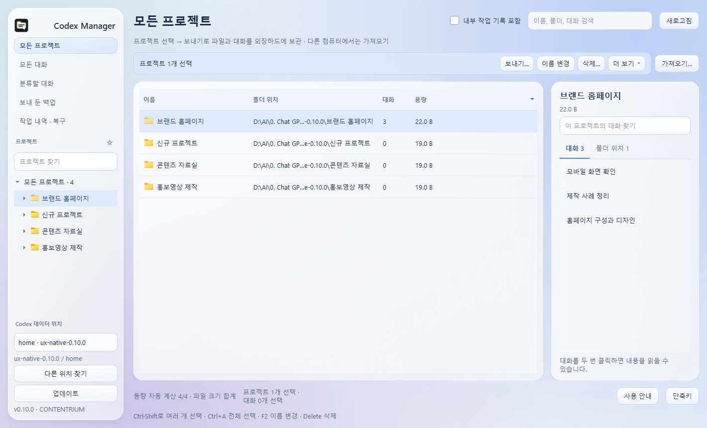

# Codex Manager

Codex의 **프로젝트·대화·작업 파일을 한곳에서 관리**하세요. 외장하드에 함께 보관하고, 다른 컴퓨터에서 원하는 프로젝트로 가져올 수 있습니다.

**Windows x64** · 설치파일을 실행하면 최신 앱을 자동으로 내려받습니다. 인터넷 연결이 필요하며, 받은 설치파일은 다음 버전에도 그대로 사용할 수 있습니다.

## 작업에 집중할 수 있도록

- **탐색기처럼 정리** — 여러 항목 선택, 끌어 놓기, 열 제목 정렬, F2 이름 변경과 Delete 삭제.
- **프로젝트와 대화를 함께 관리** — 이름 변경, 대화 이동, 프로젝트 합치기와 폴더 연결 관리.
- **외장하드로 보내고 다른 PC로 가져오기** — 백업 상위 폴더를 선택하면 프로젝트를 찾아 새로 만들거나 기존 프로젝트에 합칩니다.
- **진행 상황과 복구 확인** — 전송 속도·처리 용량·경과 시간·예상 남은 시간, 작업 내역과 복구 가능한 삭제.

## 설치하고 시작하기

| 설치형 — 처음 사용하는 경우 | 포터블 — 설치 없이 실행 |
| --- | --- |
| 위의 **설치형 다운로드** → 실행 → 설치 폴더 선택 | 위의 **포터블 ZIP** → 새 폴더에 압축 해제 |
| 시작 메뉴에서 **Codex Manager** 실행 | `CodexManager/CodexManager.exe` 실행 |
| Windows 설정에서 제거 가능 | 실행 파일과 `_internal` 폴더를 함께 보관 |

시작할 때 업데이트를 확인하고 미리 준비합니다. **지금 업데이트**를 누르면 설치 후 다시 실행하며, 왼쪽 **업데이트**에서도 확인할 수 있습니다.

## 다른 컴퓨터로 옮기기

1. **원래 컴퓨터:** 프로젝트 선택 → **보내기…** → 외장하드 폴더 선택.
2. **다른 컴퓨터:** Codex와 Manager 준비 → **가져오기…** → 백업이 들어 있는 상위 폴더 선택.
3. **새 프로젝트로 가져오기** 또는 **기존 프로젝트에 합치기**를 고르고 저장 위치를 확인합니다.

기존 프로젝트에 합치면 대상 프로젝트 이름을 유지합니다. 원래 컴퓨터와 외장하드의 내용은 자동으로 삭제하지 않습니다. 프로젝트 연결 변경·가져오기·삭제는 Codex 앱을 종료한 뒤 진행하세요. 조회와 보내기는 Codex 실행 중에도 사용할 수 있습니다.

**프로그램 ZIP은 작업 백업과 별개입니다.** 설치형과 포터블 모두 Manager 설정은 `%LOCALAPPDATA%/ProjectConversationManager`에 저장합니다. Codex 대화는 사용하는 Codex 데이터 위치에, 작업 파일은 프로젝트 폴더에 있습니다. 대화와 파일을 함께 옮길 때는 **보내기 / 가져오기**를 사용하세요.

[사용 안내와 단축키](docs/user-guide.md) · [최신 변경 내용](https://github.com/contentriumkorea/codex-manager/releases/latest) · [문제 신고](https://github.com/contentriumkorea/codex-manager/issues)

검증 범위와 개발 자료

파일과 대화의 이동·합치기·삭제는 격리된 테스트 저장소에서 검증합니다. 실제 계정의 두 번째 물리 PC 이어쓰기와 모바일 표시는 별도 검수가 필요합니다. [호환성 및 검증 범위](docs/compatibility.md)를 확인하세요.

[개발·배포 안내](docs/releasing.md) · [0.10.4 배포 점검 범위](docs/release-audit-0.10.4.md)

로컬 Codex용 독립 도구이며 OpenAI 공식 제품은 아닙니다.

