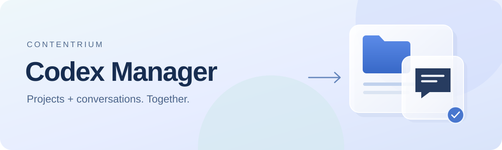
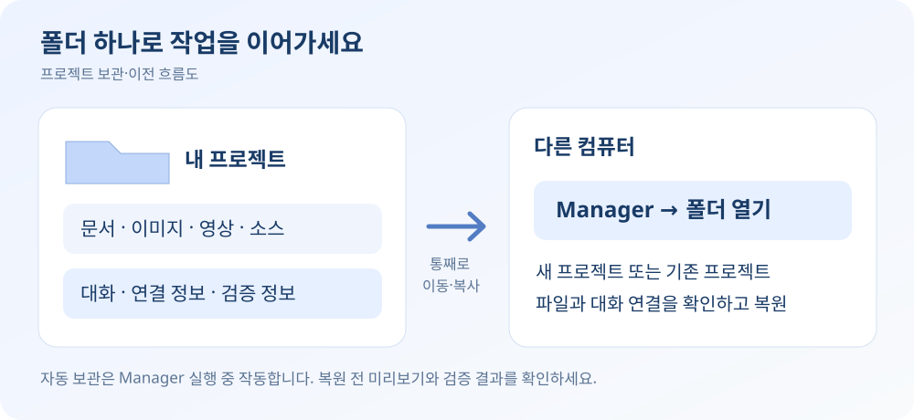

<p align="center">
  
</p>

<h1 align="center">Codex Manager</h1>

<p align="center">
  <strong>프로젝트·대화·작업 파일을 한곳에서 관리하세요.</strong><br>
  프로젝트 폴더에 대화를 자동 보관하고, 다른 컴퓨터에서 그 폴더를 열어 작업을 이어가는 Windows 앱입니다.
</p>

<p align="center">
  <a href="https://github.com/contentriumkorea/codex-manager/releases/latest"></a>
  <a href="#적용-범위와-제한"></a>
  <a href="#적용-범위와-제한"></a>
</p>

<p align="center">
  <a href="#빠르게-시작하기">설치하기</a> ·
  <a href="https://github.com/contentriumkorea/codex-manager/releases/download/installer-v1/Codex-Manager-Setup.exe">다운로드</a> ·
  <a href="#사용-모습">사용 모습</a> ·
  <a href="docs/user-guide.md">상세 안내</a>
</p>

---

## 빠르게 시작하기

**Windows x64 · 인터넷 연결 필요.** 약 2.5 MB 설치파일이 최신 앱을 내려받습니다. 받은 설치파일은 다음 버전에도 그대로 사용할 수 있습니다.

<p align="center">
  <a href="https://github.com/contentriumkorea/codex-manager/releases/download/installer-v1/Codex-Manager-Setup.exe"></a>
  <a href="https://github.com/contentriumkorea/codex-manager/releases/latest/download/Codex-Manager-Windows-x64.zip"></a>
</p>

설치파일 실행 → 설치 폴더 선택 → 시작 메뉴에서 **Codex Manager** 실행.

[상세 설치 및 업데이트 안내 →](docs/user-guide.md)

## 작업을 정리하고, 함께 옮기세요

| 01 · 탐색기처럼 정리 | 02 · 폴더에 대화 자동 보관 | 03 · 폴더를 열어 복원 |
| :--- | :--- | :--- |
| **익숙한 조작으로 빠르게** | **작업 파일과 같은 폴더에** | **다른 컴퓨터에서도 이어서** |
| 여러 항목 선택, 열 제목 정렬, F2 이름 변경과 Delete 삭제. 필요할 때 목적지 탐색기를 열어 복사·이동. | 프로젝트별 자동 보관, 지금 보관, 마지막 성공 시각과 오류 확인. 압축 대화와 내부 기록도 검증. | 프로젝트 폴더를 통째로 복사한 뒤 폴더 열기. 새 프로젝트로 복원하거나 기존 프로젝트에 합치기. |

## 사용 모습

<p align="center">
  
</p>

**주 화면에서 프로젝트·대화·파일을 관리하고, 필요할 때 우측 목적지 탐색기를 여세요.**

우측 상단 분할 아이콘으로 목적지 폴더를 선택하고 이동·복사를 진행합니다. 프로젝트 합치기와 대화 소속 관리는 주 화면에서 처리합니다. 위 이미지는 사용 흐름도입니다. [0.13.0 변경 사항 →](docs/release-0.13.0.md)

<details>
<summary><strong>추가 예시 보기</strong></summary>

- 프로젝트나 대화를 대상 프로젝트로 끌어 놓아 합치거나 옮깁니다. **대상 프로젝트 이름을 유지**합니다.
- 프로젝트 표시 이름은 F2로 바꿉니다. 실제 작업 폴더 이름은 유지합니다.
- 자동 보관한 프로젝트 폴더를 불러오면 그 위치의 일반 파일을 사용하고, 대화를 새 작업 경로에 연결합니다. 기존 프로젝트에 합칠 때는 대상 프로젝트 이름을 유지합니다.
- 일반 파일은 파일 보기에서 확인하고 기본 프로그램으로 엽니다. 대화 보관을 켜기 위해 일반 파일을 한 번 더 압축할 필요가 없습니다.

[화면별 사용법과 단축키 →](docs/user-guide.md)

</details>

## 설치형과 포터블

| 방식 | 사용 방법 |
| :--- | :--- |
| **설치형 · 처음 사용하는 경우** | 작은 설치파일이 최신 앱을 내려받습니다. 시작 메뉴에서 실행하고 Windows 설정에서 제거할 수 있습니다. |
| **포터블 · 설치 없이 실행** | ZIP을 새 폴더에 풀고 `CodexManager/CodexManager.exe`를 실행합니다. 실행 파일과 `_internal` 폴더를 함께 보관하세요. |
| **앱 업데이트** | 시작할 때 업데이트를 확인하고 미리 준비합니다. **지금 업데이트**를 누르면 설치 후 다시 실행합니다. 공통 **업데이트**에서도 확인할 수 있습니다. |

설치형과 포터블 모두 Manager 설정·작업 내역은 `%LOCALAPPDATA%/ProjectConversationManager`에 저장합니다. Codex의 실제 대화 저장소를 유지하면서, 자동 보관을 켠 프로젝트 폴더의 `.codex-manager`에 대화 사본과 연결 정보를 저장합니다. 작업을 이전할 때는 이 숨김 폴더를 포함한 프로젝트 폴더 전체를 복사하세요.

## 이렇게 사용하세요

```text
원래 컴퓨터: 프로젝트 선택 → 대화 자동 보관 켜기 → 저장 결과 확인
보관·이전: 프로젝트 폴더 전체를 외장하드나 다른 컴퓨터로 복사
다른 컴퓨터: Codex 로그인 후 종료 → Manager에서 폴더 열기
프로젝트 선택 → 새 프로젝트 또는 기존 프로젝트에 합치기 → 복원
```

원래와 다른 경로에서도 복원할 수 있습니다. 자동 보관은 Manager 실행 중에 작동하며 원본을 삭제하지 않습니다. 기존 형식 백업은 가져오기 기능을 계속 사용합니다. [자동 보관·복원 및 원본 정리 안내](docs/user-guide.md)를 확인하세요.

## 적용 범위와 제한

- 로컬 Windows x64의 Codex 프로젝트와 대화를 관리합니다. 새 컴퓨터의 Codex 로그인은 별도로 진행합니다.
- 프로젝트 연결 변경·가져오기·삭제는 Codex 앱을 종료한 뒤 진행하세요. 조회와 보내기는 Codex 실행 중에도 사용할 수 있습니다.
- 프로그램 ZIP은 Manager 실행용입니다. 대화와 작업 파일을 함께 옮길 때는 자동 보관 결과를 확인하고 프로젝트 폴더를 복사하세요.
- 프로젝트 폴더의 작업 파일과 대화 보관본에는 비공개 자료가 포함될 수 있습니다. 보관 폴더를 공개 저장소에 올리지 마세요. `.codex-manager` 안에는 Git 제외 설정을 둡니다.
- 독립 첨부 파일·없는 폴더·손상된 기록·다른 프로젝트의 자식 대화 등 해결되지 않은 참조가 있으면 보관·복원 완료로 표시하지 않습니다. 기존 정상 보관본을 유지하고 원인을 표시합니다.
- 실제 계정의 두 번째 물리 PC 이어쓰기와 모바일 표시는 별도 검수가 필요합니다. [호환성 및 검증 범위](docs/compatibility.md)를 확인하세요.
- 처음 실행할 때 포함 구성요소 이용약관을 확인합니다. [개인정보·구성요소 안내](docs/third-party.md)에서 Microsoft SmartScreen 및 런타임 약관을 볼 수 있습니다.
- 이 저장소에는 별도의 오픈소스 라이선스가 지정되어 있지 않습니다.

<details>
<summary><strong>상세 안내와 검증 범위</strong></summary>

파일과 대화의 이동·합치기·삭제는 격리된 테스트 저장소에서 검증합니다. 배포 과정에서는 설치·업데이트·제거, 포터블 실행, 공개 다운로드의 해시와 버전을 확인합니다.

[사용 안내](docs/user-guide.md) · [호환성](docs/compatibility.md) · [개발·배포 안내](docs/releasing.md) · [배포 점검 범위](docs/compatibility.md) · [문제 신고](https://github.com/contentriumkorea/codex-manager/issues)

</details>

<details>
<summary><strong>English overview</strong></summary>

Codex Manager is an independent Windows x64 application for organizing local Codex projects, conversations, and working folders. Enable project-local conversation snapshots, copy the entire project folder, and open it on another PC to restore conversations alongside the files. The optional right-hand pane browses destination folders; project and conversation management stays in the main pane.

The small online installer downloads the latest application. A portable application ZIP is also available. Automatic snapshots require Manager to remain running. Close Codex before changing project connections, restoring, or deleting. Unresolved dependencies and corrupt histories block successful portability. Cross-device continuation on a second physical PC and mobile display require separate validation.

</details>

---

<p align="center">
  <strong>CONTENTRIUM · 콘텐츠리움</strong><br>
  라이선스 미지정 ·
  <a href="https://github.com/contentriumkorea/codex-manager/releases/latest">Latest release</a>
</p>

<sub>Codex Manager는 로컬 Codex용 독립 도구이며 OpenAI 공식 제품은 아닙니다.</sub>

<p align="center">
  <a href="https://contentrium.com/"></a>
</p>
